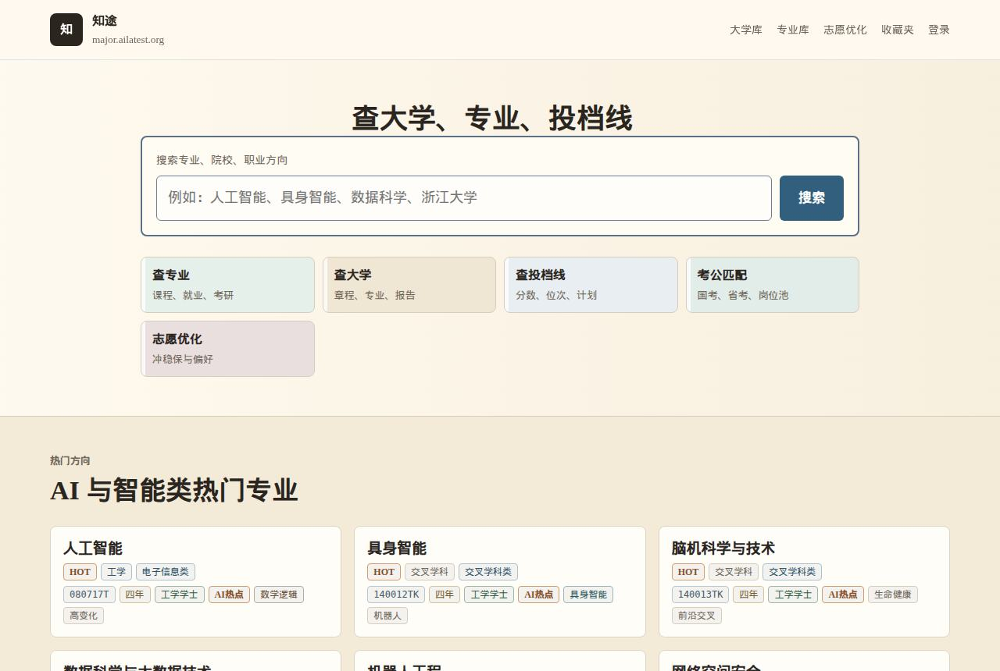
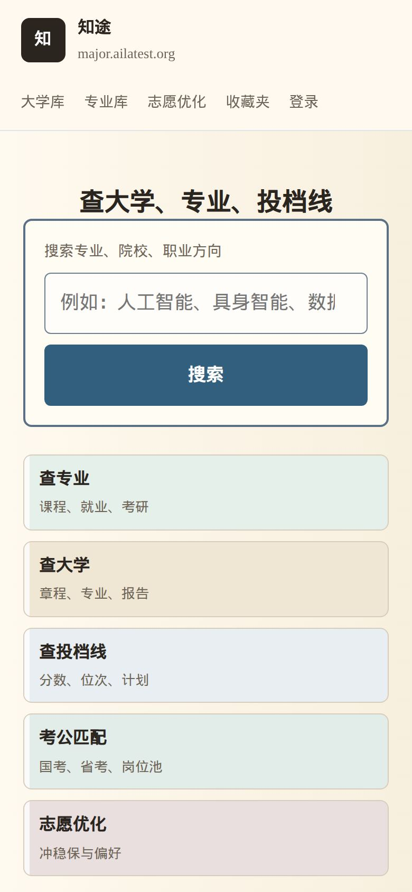
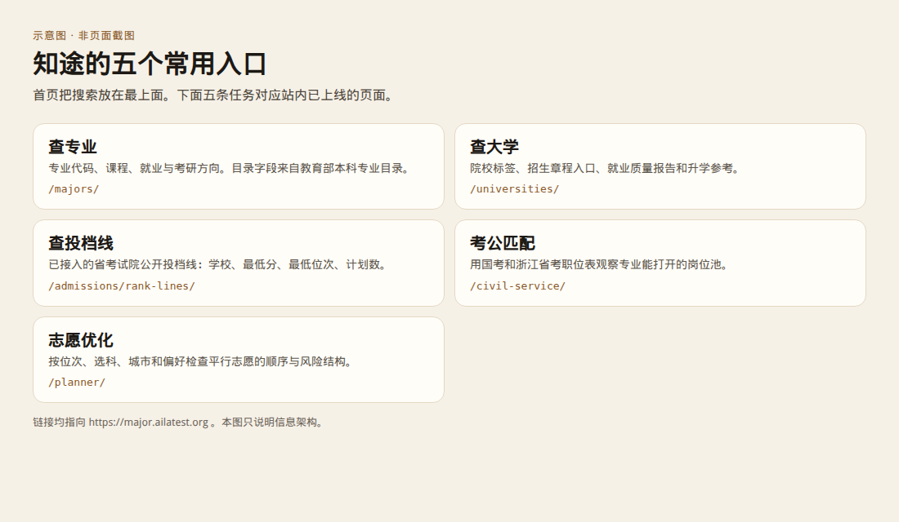
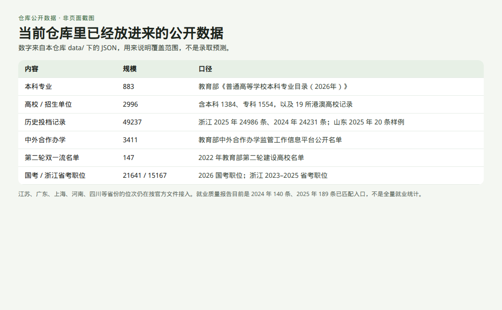
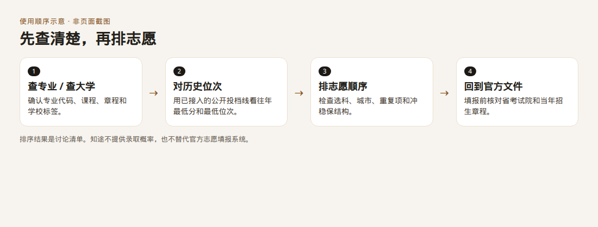
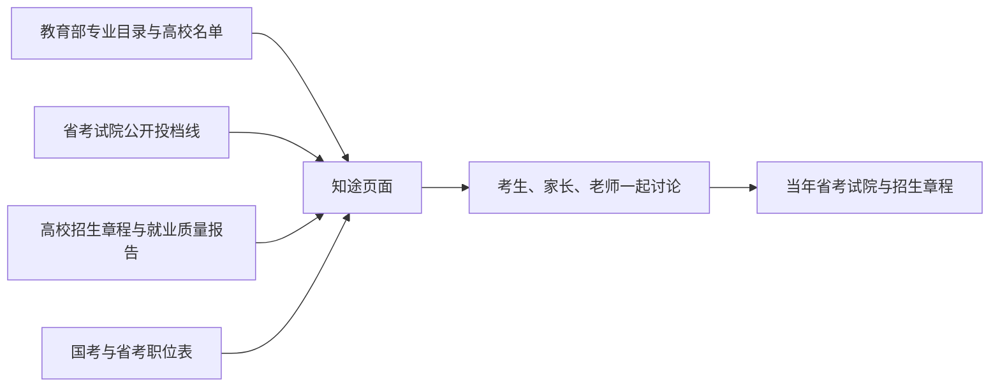

# 知途 · AILatest Major

面向中国高考考生、家长和老师的公开数据专业百科与志愿排序助手。

**在线使用：[major.ailatest.org](https://major.ailatest.org/)** · 工作室：[ailatest.org](https://ailatest.org/zh/) · 联系：[contact@ailatest.org](mailto:contact@ailatest.org)

知途把专业目录、院校信息和已经公开的历史投档线放在同一个地方，用来查专业、查大学、看往年位次，并把志愿清单整理成一份可以一起讨论的顺序。历史位次和排序结果只供决策参考。正式填报以省教育考试院、高校招生章程和官方志愿系统为准。



*实拍，2026-10-14，[https://major.ailatest.org/](https://major.ailatest.org/)。页面标题是「查大学、专业、投档线」。*



*同一首页的手机宽度实拍。*

## 五个常用入口

| 入口 | 用来做什么 | 地址 |
| --- | --- | --- |
| 查专业 | 按专业名称、代码、课程和就业方向浏览本科专业 | [/majors/](https://major.ailatest.org/majors/) |
| 查大学 | 看院校标签、招生章程入口、就业质量报告和升学参考 | [/universities/](https://major.ailatest.org/universities/) |
| 查投档线 | 查看已接入的公开投档线：学校、最低分、最低位次、计划数 | [/admissions/rank-lines/](https://major.ailatest.org/admissions/rank-lines/) |
| 考公匹配 | 用国考和浙江省考职位表观察一个专业能打开的岗位池 | [/civil-service/](https://major.ailatest.org/civil-service/) |
| 志愿优化 | 按位次、选科、城市和偏好检查平行志愿的顺序 | [/planner/](https://major.ailatest.org/planner/) |

首页还有一个选专业小问卷。匹配结果只反映兴趣标签，不代表录取或就业结果。



*结构示意，不是页面截图。链接指向线上站点。*

专业页、大学页和对比页还可以继续往下看，例如：

- [人工智能](https://major.ailatest.org/major/artificial-intelligence/)
- [人工智能和计算机科学与技术怎么选](https://major.ailatest.org/comparison/artificial-intelligence-vs-computer-science/)
- [浙江大学](https://major.ailatest.org/university/zhejiang-university/)
- [中外合作办学库](https://major.ailatest.org/universities/cooperation/)
- [按位次看历史参考](https://major.ailatest.org/admissions/match/)
- [各省投档数据进度](https://major.ailatest.org/admissions/rank-sources/)

## 仓库里的公开数据

下面的数字来自本仓库 `data/` 目录，描述的是当前公开数据包，不是全国录取预测。

| 内容 | 规模 | 口径 |
| --- | --- | --- |
| 本科专业 | 883 | 教育部《普通高等学校本科专业目录（2026年）》：13 个门类、92 个专业类 |
| 高校 / 招生单位 | 2996 | 本科 1384、专科 1554，其余 58 条层次以教育部名单和招生章程为准；其中 19 条为港澳高校 |
| 历史投档记录 | 49237 | 浙江 2025 年 24986 条、2024 年 24231 条；山东 2025 年 20 条公开样例 |
| 中外合作办学 | 3411 | 教育部中外合作办学监管工作信息平台公开名单，其中独立法人 16 条 |
| 第二轮双一流名单 | 147 | 2022 年第二轮建设高校。首轮 A/B 只作历史分类 |
| 国考职位 | 21641 个职位，计划 39413 人 | 2026 年国考职位表 |
| 浙江省考职位 | 15167 个职位，计划 21613 人 | 2023–2025 年 |
| 就业质量报告入口 | 2024 年 140 条，2025 年 189 条 | 已匹配到院校的公开报告入口和摘要，不是全量就业统计 |
| 学科评估样本 | 12 个一级学科 | 第四轮学科评估里的高关注学科，不是完整评估榜 |
| 专业对比 / 专题 | 5 篇对比，7 个专题 | 含 AI、考公、就业面等工作场景专题 |

院校卡片上的 `985` 标记目前有 38 所，`211` 标记有 112 所。这些是历史工程标签，和当年录取难度不是同一件事。



*数据规模示意，不是页面截图。*

江苏、广东、上海、河南、四川等省份的位次，按省考试院公开文件继续接入。只有院校专业组的省份，页面按专业组展示，不写成单个专业的录取位次。

## 使用顺序



*使用顺序示意，不是页面截图。*



志愿排序页提供「填入浙江样例」。样例用来看排序结构，其中的学校和专业来自页面内置示例，不是某位考生的录取结果。

## 数据与编辑边界

事实字段优先来自这些公开来源：

1. 教育部本科专业目录，以及全国高等学校名单
2. 阳光高考专业知识库和院校库
3. 省教育考试院、高校招生网和公开招生章程
4. 第二轮双一流名单、学科评估公开结果、中外合作办学监管平台
5. 国家公务员局职位表、浙江省考职位表、高校就业质量报告

AI 写的专业解释单独存放，并保留 `source_note`。它用来帮助阅读，不作为事实来源。分数和位次写成历史参考区间。商业志愿填报数据库不在收录范围。

方法、来源和纠错入口：

- [数据来源](https://major.ailatest.org/data-sources/)
- [方法说明](https://major.ailatest.org/methodology/)
- [编辑政策](https://major.ailatest.org/editorial-policy/)
- [反馈与纠错](https://major.ailatest.org/feedback/)
- [关于知途](https://major.ailatest.org/about/)

## 产品家族

知途是 [AILatest](https://ailatest.org/zh/) 的高考专业与志愿工具。同一工作室还维护：

| 产品 | 做什么 | 地址 |
| --- | --- | --- |
| Journal 知刊 | 期刊检索、分区与预警 | [journal.ailatest.org](https://journal.ailatest.org/) |
| Path | 美国院校的费用、认证与结果信号 | [path.ailatest.org](https://path.ailatest.org/) |
| Major 知途 | 高考专业百科与志愿排序 | [major.ailatest.org](https://major.ailatest.org/) |
| Skill | 科研写作、绘图和基金材料的公开 Skill 合集 | [stonecanon/ailatest-skill](https://github.com/stonecanon/ailatest-skill) |
| RefCheck 文献侦探 | 逐条核对参考文献，并标出撤稿 | [refcheck.ailatest.org](https://refcheck.ailatest.org/) |

## 本仓库

这里是知途的公开站点仓库：静态页面生成器、公开种子数据和 Cloudflare Pages 配置。本地预览：

```bash
npm install
npm run check
npm run build
npm run dev
```

默认地址是 `http://localhost:4173`。端口被占用时：

```bash
node scripts/serve.mjs dist 4183
```

公开数据的导入步骤写在 [imports/README.md](imports/README.md) 和 [docs/data-ingestion.md](docs/data-ingestion.md)。部署与检索检查写在 [docs/deployment-status.md](docs/deployment-status.md) 和 [docs/launch-seo-checklist.md](docs/launch-seo-checklist.md)。原始官方附件放在被 git 忽略的 `raw/`，不随仓库分发。

问题与数据纠错可以开 [GitHub Issue](https://github.com/stonecanon/ailatest-major/issues)，或使用站内 [反馈页](https://major.ailatest.org/feedback/)。请附上公开来源链接，不要提交身份证号、准考证号或验证码。

## 还需要补上的实拍

本次只拍到了首页。专业库、大学页、志愿排序、投档线和考公匹配在抓取时被 Cloudflare 拦截。上面的结构图和数据图是根据仓库内容和线上首页整理的示意，不是那些页面的截图。

建议之后补上这些真实截图，放到 `docs/screenshots/`：

- `/majors/` 专业库搜索
- `/major/artificial-intelligence/` 专业详情
- `/universities/` 与 `/university/zhejiang-university/`
- `/planner/` 点击「填入浙江样例」之后的排序结果
- `/admissions/rank-lines/` 与 `/admissions/match/`
- `/civil-service/` 岗位池表格
- `/comparison/artificial-intelligence-vs-computer-science/`

---

# English

**ZhiTu (AILatest Major)** is a public-data major encyclopedia and volunteer-list planner for China’s gaokao.

**Live site: [major.ailatest.org](https://major.ailatest.org/)** · Studio: [ailatest.org](https://ailatest.org/en/) · [contact@ailatest.org](mailto:contact@ailatest.org)

Search undergraduate majors and universities, read public admission rank lines that have already been imported, and turn a list of choices into an order a student and family can discuss. Historical ranks are reference bands. The official provincial exam authority, the university admissions charter, and the official filing system decide the application.


*Captured 2026-10-14 from [https://major.ailatest.org/](https://major.ailatest.org/).*

## What you can open

| Task | What it is | URL |
| --- | --- | --- |
| Majors | Codes, courses, careers, and postgraduate directions for 883 undergraduate majors in the 2026 Ministry of Education catalog | [/majors/](https://major.ailatest.org/majors/) |
| Universities | Institution pages, charter links, employment-report entrances, and further-study notes | [/universities/](https://major.ailatest.org/universities/) |
| Rank lines | Imported public filing lines: school, minimum score, minimum rank, and plan count | [/admissions/rank-lines/](https://major.ailatest.org/admissions/rank-lines/) |
| Civil-service match | How wide a major’s job pool looks in the 2026 national exam and Zhejiang 2023–2025 exams | [/civil-service/](https://major.ailatest.org/civil-service/) |
| Planner | Order a parallel-volunteer list by rank, subjects, cities, and preferences | [/planner/](https://major.ailatest.org/planner/) |

The homepage quiz matches interest tags only. It is not an admissions or employment result.


*Diagram, not a screenshot.*

## What the public dataset contains

Counts below are from this repository’s `data/` files.

- **883** undergraduate majors from the 2026 catalog.
- **2,996** institutions and admission units: 1,384 undergraduate, 1,554 junior-college, 58 records whose level stays tied to the Ministry list and the charter, including **19** Hong Kong and Macau institutions.
- **49,237** historical filing rows: Zhejiang 2025 (24,986), Zhejiang 2024 (24,231), and a 20-row Shandong 2025 sample. Other provinces are still waiting on their official files.
- **3,411** Sino-foreign cooperative programs from the Ministry’s public CRS lists.
- **147** universities from the 2022 second-round Double First-Class list.
- **21,641** national civil-service positions for 2026 (39,413 planned recruits) and **15,167** Zhejiang positions for 2023–2025 (21,613 planned recruits).
- Employment-report entrances matched to universities: **140** for 2024 and **189** for 2025. These are source links and extracted summaries, not a national employment census.
- **12** first-level disciplines from the public fourth-round evaluation, **5** major comparisons, and **7** topic pages.


*Diagram, not a screenshot.*


*Diagram, not a screenshot. The planner’s “浙江样例” button fills a built-in Zhejiang example so the ordering screen can be inspected. It is not a student’s admission result.*

## Boundaries

Facts come from public sources: the Ministry of Education, CHSI / Yangguang Gaokao, provincial examination authorities, university admissions sites, the Double First-Class list, the Sino-foreign cooperation registry, civil-service position tables, and university employment-quality reports.

AI explanations keep a `source_note` and stay separate from factual fields. Commercial volunteer-filling databases are outside this collection. Pages describe historical reference bands, list structure, and risk notes. They do not state an admission probability.

- [Data sources](https://major.ailatest.org/data-sources/)
- [Methodology](https://major.ailatest.org/methodology/)
- [Editorial policy](https://major.ailatest.org/editorial-policy/)
- [Corrections](https://major.ailatest.org/feedback/)

## Product family

| Product | Role | URL |
| --- | --- | --- |
| Journal | Journal search, indexes, and warning lists | [journal.ailatest.org](https://journal.ailatest.org/) |
| Path | U.S. college cost, accreditation, and outcome signals | [path.ailatest.org](https://path.ailatest.org/) |
| Major (知途) | Gaokao majors and volunteer ordering | [major.ailatest.org](https://major.ailatest.org/) |
| Skill | Public research, figure, and proposal skills | [ailatest-skill](https://github.com/stonecanon/ailatest-skill) |
| RefCheck (文献侦探) | Citation checks and retraction flags | [refcheck.ailatest.org](https://refcheck.ailatest.org/) |

## This repository

This public repository holds the static-site generator, public seed data, and Cloudflare Pages config. Production accounts and raw official attachments are not in git.

```bash
npm install
npm run check
npm run build
npm run dev
```

Local preview defaults to `http://localhost:4173`. Import rules live in [imports/README.md](imports/README.md) and [docs/data-ingestion.md](docs/data-ingestion.md).

Please open a [GitHub Issue](https://github.com/stonecanon/ailatest-major/issues) or use the [feedback page](https://major.ailatest.org/feedback/) for corrections, and include a public source link.

Screenshots of the major library, a university page, the planner, rank lines, and the civil-service table still need to be added under `docs/screenshots/`. Cloudflare blocked those URLs during this pass, so those sections use labeled diagrams instead of fabricated page images.
