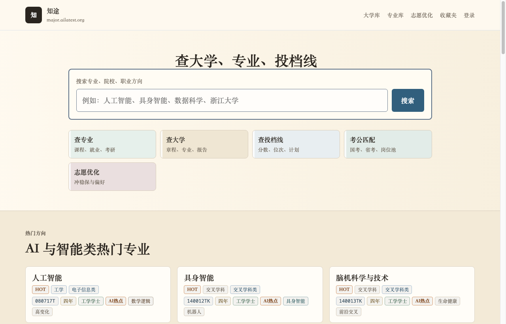

# AILatest Major · 知途 🧭

  <b>800+ 大学专业真实培养方案与核心课程依赖图谱对比。</b> 
  透视大学四年到底学什么、怎么学、毕业去哪儿，打破高考选科与考研跨考的信息壁垒。

  
  

---

## 🖼 视觉预览 · Visual Overview

### 1. 官方封面插画

  

### 2. 真实在线课程图谱截图 (Live Application Interface)

  

<em>界面截图截取自线上站点 <a href="https://major.ailatest.org/">major.ailatest.org</a>。</em>

---

## 🌟 核心解决痛点

很多同学填报专业时仅凭专业名称遐想，入学后才发现课程与预期大相径庭。**知途 (Major)** 提供：
1. **800+ 专业官方培养方案**：收录教育部目录及顶尖高校真实教学计划；
2. **前置先修与课程依赖关系树**：直观展示哪些是通识必修、学科基础、专业核心与进阶选修；
3. **真实就业去向与学长学姐反馈**：客观分析考研、出国、考公、体制外企业就业的真实比例。

---

## 🌐 在线探索专业培养方案

立即查询目标专业：[**https://major.ailatest.org/**](https://major.ailatest.org/)\n